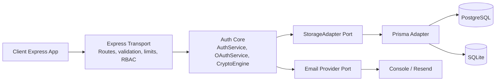

# universal-auth-plugin

## B2B Authentication, Ready to Integrate

Deliver secure authentication and tenant-aware authorization without building a custom identity platform from scratch. For a standard Express/Prisma application, the packaged schema and runbook are designed for a first integration in under 10 minutes; bespoke authentication engineering commonly takes weeks.

## Why Teams Choose It

- **Fast time to market:** Ready-to-mount registration, login, refresh, email verification, password reset, and OAuth routes.
- **Hexagonal, replaceable components:** Framework-neutral core ports isolate business rules from transport and persistence. Prisma supports PostgreSQL and SQLite through generated clients; storage and rate-limit interfaces allow other adapters to be introduced without changing the domain services.
- **Practical security controls:** Rotating opaque refresh tokens, Zod request validation, sliding-window limits with `Retry-After`, and tenant RBAC that rechecks live membership. A local k6 verification confirms five invalid login responses are followed by `429` and a positive `Retry-After`; this is a functional rate-limit check, not a capacity benchmark.
- **Tenant-aware authorization:** Organization roles (`OWNER`, `ADMIN`, `MEMBER`) are included in scoped access tokens and enforced against current storage membership.

## Architecture



The application owns its framework and database deployment; the plugin provides reusable auth policy and adapters. Prisma is optional unless the Prisma subpath is used. Express and Zod are optional peers for consumers using the Express transport.

## Start Here

```sh
npm install universal-auth-plugin @prisma/client express zod cookie-parser
npm install --save-dev prisma
```

See the [Client Implementation Runbook](./RUNBOOK.md) for schema setup, environment variables, full Express wiring, tenant middleware, and deployment verification.
